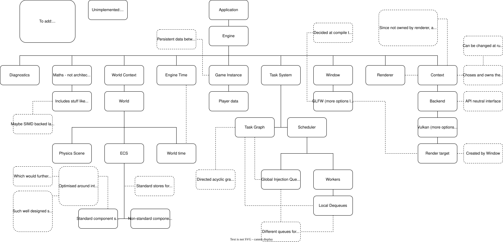

# Trivial Engine

Documentation update is in progress. Once it is complete, this README will be
updated appropriately. The information below is nonetheless correct, but it is
somewhat ad hoc and will be reorganised and expanded.

A game engine designed for 2.5D games. The design will be more specialised and
directed towards the creation of a game with myself and a friend. The creation
of the engine is to allow for complete freedom in the development of the game.

Build tooling (including grabbing dependencies) is handled via CMake, but built
on top is a python script that is recommended for usage for building and
especially for testing since some tests require running in isolated processes,
due to global state. The build script also ties in clang toolings for static
analysis and formatting to help keep the codebase consistent and clean.

Early testing has shown full functionality across Windows, Linux, and MacOS,
along with ARM64 and x86_64 architectures, but please report any issues found.

Licensed under the [Apache License, Version 2.0](LICENSE). Games and other
software built with the engine can use any licence, but must keep the
[NOTICE.md](NOTICE.md) file's attribution somewhere a user could reasonably
find it (e.g. a credits screen, documentation, or an in-app NOTICE display).
NOTICE.md also lists the engine's third-party dependencies and their licence
terms, and credits design references where deemed appropriate. A note on this
is it need not be a title screen as that can often interfere with the feel of a
game, and as such implementation of accreditation is deferred to the user.

Some documentation can be found in this repository, this documentation is not
complete, due to some bits with work ongoing and without a proper release
schedule keeping to having full documentation for each component added that may
likely change later. It is a personal project so a great formality of this is
neglected prior to a proper version 1.0.0.

The engine architecture can be seen below:

